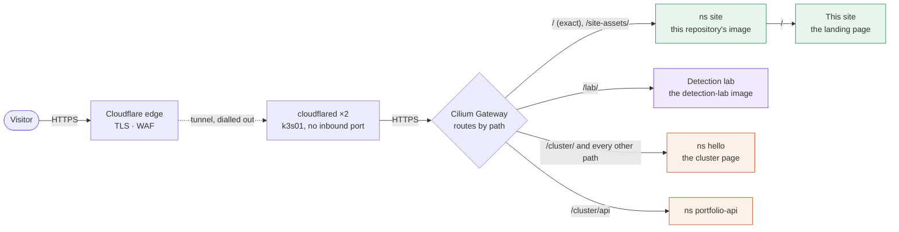
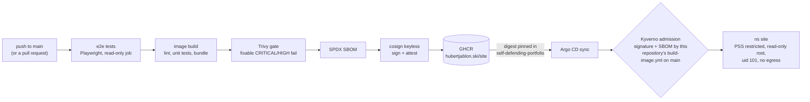

# hubertjablon.ski

The site at https://hubertjablon.ski/: the landing page and the pages of projects that do not run
their own deployment.

| Path | What | Source |
|---|---|---|
| `/` | Landing page: intro, project cards, "The way in" diagram, About | `src/landing.html`, `src/landing.ts`, `src/diagram/` |
| `/cluster/`, `/cluster/api` | Self-defending cluster | [self-defending-portfolio](https://github.com/HubertMJ/self-defending-portfolio) |

Assets live under `/site-assets/`, not `/assets/`: both images sit behind one hostname, and
`/assets/`, `/favicon.svg` and `/robots.txt` belong to the cluster page. The Gateway sends `/`
(exact) and `/site-assets/` here and everything else to self-defending-portfolio.

The landing page sends old single-page links (`/#verify`, `/?mock=1`, ...) on to `/cluster/`.

The detection lab page lives in its own repository, [detection-lab](https://github.com/HubertMJ/detection-lab),
with its own deployed image; the Gateway serves `/lab/` from it. The landing page keeps the Detection
lab card and diagram node, which link to `/lab/`.

The `/work/` pages (the vLLM deployment manager mock-up, the git forge bridge and Flota) live in their
own repository too, work-mockups, with their own image; the Gateway is to serve `/work/` from it. The
landing page carries their three project cards, which link under `/work/`.

## How a request reaches it



Green is this repository; orange is [self-defending-portfolio](https://github.com/HubertMJ/self-defending-portfolio),
which also holds the cluster manifests that run this image (`cluster/infra/site/`); violet is
[detection-lab](https://github.com/HubertMJ/detection-lab), which builds and runs the `/lab/` page's
own image. The landing page draws the same path in its "The way in" section, from
`src/diagram/model.ts` at build time
(`scripts/build.mjs`): a dot runs each route in turn (not with reduced motion), and every box but
the page you are on opens its page. A unit test holds this diagram to the model's routes.

## From commit to running pod



Pull requests stop after the e2e tests: only `main` builds, pushes and signs.

## Develop

```sh
npm ci --ignore-scripts
npm run lint && npm test       # typecheck, unit tests (vitest)
npm run build                  # dist/
npm run serve -- --port 4173   # static server for dist/
npm run test:e2e               # playwright (desktop + phone)
```

`PW_CHROMIUM_PATH` points Playwright at a preinstalled Chromium when the bundled one is missing.

## Rules the code keeps

- CSP `style-src 'self'` and Trusted Types: no inline styles or `innerHTML`; the DOM is built with
  `h()`/`replace()` from `src/lib/dom.ts`, dynamic sizes go through `style.setProperty`.
- The page never scrolls or jumps by itself; a click redraws only its own panel.

## Image

`Dockerfile` builds the bundle (lint, unit tests, build) and serves `dist/` from
nginx-unprivileged on :8080 with the headers in `security-headers.conf`.
`.github/workflows/build-image.yml` runs the e2e tests, then on `main` builds
`ghcr.io/hubertmj/hubertjablon.ski/site`, gates it with Trivy, attests an SPDX SBOM and signs it
keylessly with cosign.

The cluster side (the `site` namespace, its HTTPRoute, the Argo CD application and the Kyverno
rules that pin this workflow's identity) lives in self-defending-portfolio under
`cluster/infra/site/`. A new image reaches the cluster when its digest is committed there.
